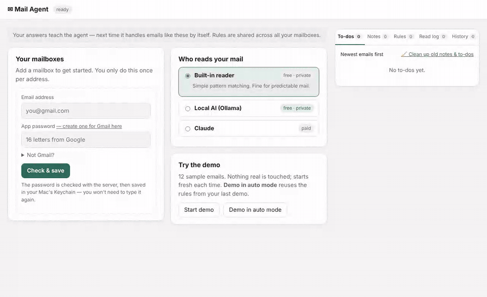
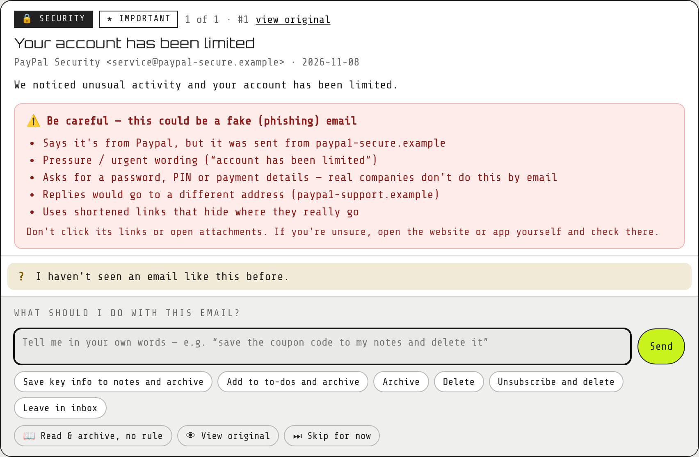
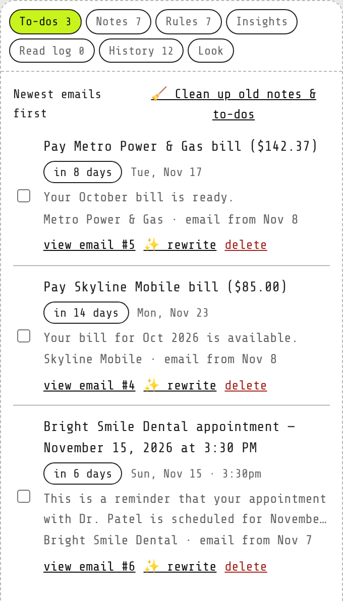
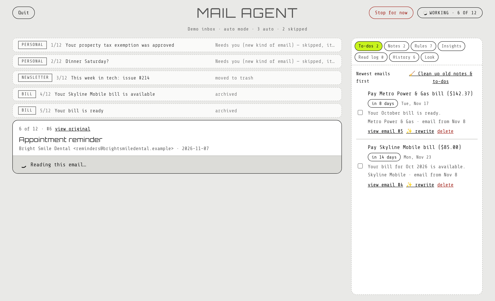
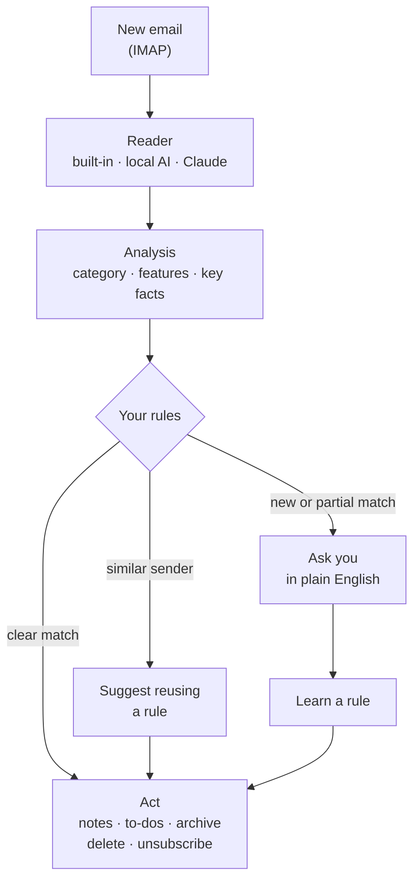

# Mail Agent

[](https://github.com/Karska-dev/mail-agent/actions/workflows/tests.yml)
[](LICENSE)


**A private email assistant that runs on your own Mac.** It reads your inbox, asks what to do with emails it hasn't seen before, and turns your plain-English answers into rules it applies automatically from then on. The AI can run locally, so your mail never has to leave your computer.



<sub>The built-in demo: one answer teaches a rule, the next coupon email is handled on its own, and an ad without a coupon gets a question instead of a wrong guess.</sub>

## Why it's different

- **Private by design.** It runs on your computer and talks only to your mail server. With the built-in reader or local AI ([Ollama](https://ollama.com)), no email text goes anywhere else.
- **Learns from plain English.** Say "save the coupon code to my notes and delete it" once; it becomes a rule for that sender, or for every sender if you choose.
- **Asks instead of guessing.** It tells an exact match from a partial one ("your rule saves coupon codes, but this email has none") and suggests reusing a workflow for similar senders.
- **Turns mail into to-dos and notes** with plain titles, the one link that matters, and dates that stand out.
- **Safe to try.** Practice mode changes nothing, every handled email is kept so you can restore it, and possible scams get a clear warning.

## Get it

**Mac app** (Apple Silicon, macOS 12+): download **Mail-Agent-mac-apple-silicon.zip** from the [latest release](https://github.com/Karska-dev/mail-agent/releases/latest), unzip it and move **Mail Agent** to Applications. It isn't signed by Apple, so macOS blocks the first launch:
- macOS 15 or newer: open **System Settings → Privacy & Security** and click **Open Anyway**;
- macOS 14 or older: right-click the app and choose **Open**.

The app opens in your browser and has no Dock icon; quit it with the **Quit** button on the page.

**With Python 3.10+** (no other dependencies):

```bash
pipx install git+https://github.com/Karska-dev/mail-agent
mail-agent            # opens the app in your browser
```

Click **Start demo** to try it with 12 sample emails, or add your Gmail with an [app password](https://myaccount.google.com/apppasswords) and start in **Practice mode**. The [user guide](docs/GUIDE.md) covers everything else.

## A closer look

<table>
<tr>
<td width="62%" valign="top"></td>
<td valign="top"></td>
</tr>
<tr>
<td valign="top"><b>Scam warnings</b> list the concrete signs: a lookalike sender, pressure wording, requests for passwords, hidden links.</td>
<td valign="top"><b>To-dos</b> with plain titles, the key link, and a date chip that turns lime when something is overdue or due tomorrow.</td>
</tr>
</table>



**Auto mode** works through a whole inbox without asking anything: rules handle what they can, the to-do list fills up as it goes, and anything that needs you stays unread for your next session.

## How it works



Every reader produces the same structured analysis: a category (promotion, bill, appointment…), features (has a coupon, has a deadline, amount due…) and the facts worth keeping. A rule is a scope (one sender or any), a category, the features it needs and the ones it must not have, plus the actions to take. More details are in the [user guide](docs/GUIDE.md#how-it-works).

## Privacy

- Mail passwords and the optional Claude API key are kept in the macOS Keychain.
- Rules, notes, to-dos and copies of handled emails stay in `~/.email_agent` on your computer.
- The app's page is served only to your own computer (`127.0.0.1`).
- Email text goes to an outside AI only if you choose Claude and add your own API key.
- Emails are shown with scripts removed and remote images blocked until you allow them. Full details: [SECURITY.md](SECURITY.md).

## Tech notes

- **Python standard library only:** `imaplib` for mail, `http.server` for the app, `urllib` for the AI APIs; no dependencies to install. About 5,400 lines, including a single-page web app with no build step.
- **Structured AI output:** Claude through a forced tool call, Ollama through JSON-schema constrained output. The rule-based reader runs alongside as a safety net, so a code or warning sign the model misses still gets through.
- **Rule matching** has five outcomes (automatic, confirm, suggest, partial, ask); sender rules beat general ones, and more specific rules beat less specific ones.
- **IMAP done carefully:** reads with `BODY.PEEK` so nothing is marked read, finds Trash and All Mail by their special-use flags so non-English Gmail works, checks every server reply before counting a move as done, notices new mail mid-session, and reconnects during long runs.
- **Local AI speed:** the next email is read while you answer the current one, known senders skip the AI, long links are shortened, and "thinking" models skip their reasoning step.
- **Safe email view:** sanitized HTML in a sandboxed frame with a no-scripts Content-Security-Policy.
- **52 tests** (pytest), run on GitHub Actions on macOS with Python 3.10 and 3.14.

## How it was built

I designed Mail Agent around my own inboxes: I decided what it should do and how it should behave, and tested it on three real Gmail accounts. The code was written with [Claude](https://claude.ai), Anthropic's AI assistant, as a pair programmer.

## More

- [User guide](docs/GUIDE.md) · [Security and privacy](SECURITY.md) · [Changelog](CHANGELOG.md)
- License: [MIT](LICENSE) © Karska-dev
